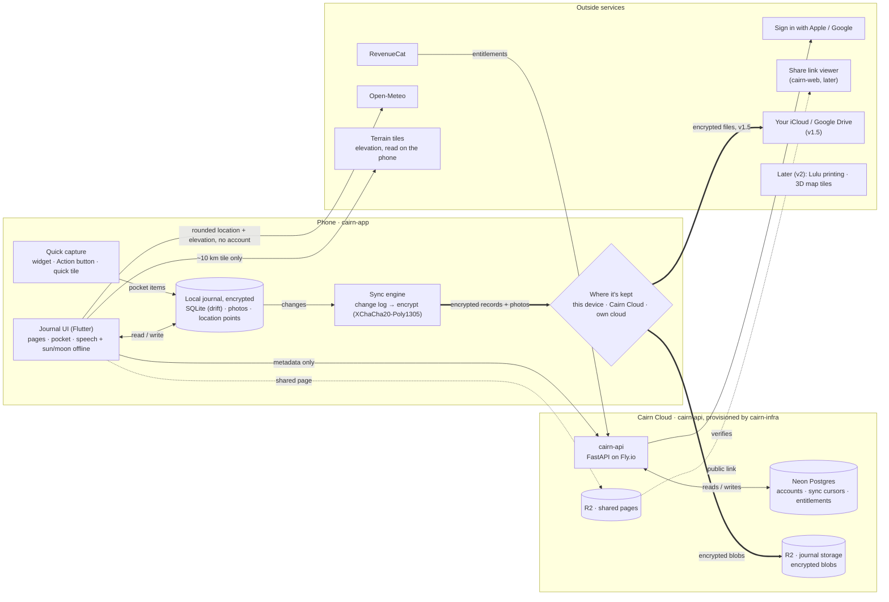

# Cairn architecture

The journal lives on the phone. It leaves the phone **only encrypted**, or as **a page the user
chose to share**. Cairn's servers hold accounts and sync bookkeeping, never journal text.

A styled version of this diagram, with the same content, is in
[`design/architecture.html`](design/architecture.html).

Line styles: thick (`==>`) = journal content, encrypted on the phone. Dotted (`-.->`) = readable
content the user chose to publish. Thin (`-->`) = metadata and service calls, no journal text.

## What crosses each boundary

| Data | Path | Can Cairn read it? |
|---|---|---|
| Pages, pocket items, photos | Phone → R2 journal storage, or the user's own iCloud / Google Drive | **No.** Encrypted on the phone; the key never leaves the user's devices. |
| Location points | Saved on the phone each time the user opens Cairn or captures something; synced like pages | **No.** Journal content, encrypted with everything else, and removed from shared pages. |
| Account and sync metadata | Phone → cairn-api → Postgres | Yes: account id, device ids, sync cursors, blob ids and sizes. No journal text, titles or places. |
| A shared page | Phone → R2 shared pages → link viewer | **Yes.** The user published it. Exact campsites are hidden by default. |
| Weather lookup | Phone → Open-Meteo, directly | Cairn never sees it. Open-Meteo gets a location rounded to about 1 km, the elevation and a date, with no account attached. |
| Elevation lookup | Phone → terrain tiles, directly | Cairn never sees it. The tile server learns only which ~10 km tile was downloaded; the exact elevation is read on the phone. |
| Purchases | App Store / Google Play → RevenueCat → cairn-api | Only which plan the user has. |
| Sign-in | Apple / Google → cairn-api | Only a verified identity token. |
| Printing (v2) | Phone → cairn-api → Lulu | Yes, for the notebook ordered, only to print it. |
| Export | Phone → the user's files | Never touches Cairn. |

## Which repo owns what

| Repo | Owns |
|---|---|
| `cairn-app` | Everything in the Phone box: the Flutter app, the local database, the sync engine and encryption, the Swift and Kotlin extensions, and the API client generated from a pinned spec. |
| `cairn-api` | The API service, the Postgres schema and migrations, signing R2 upload URLs, the RevenueCat webhook, share and print endpoints. |
| `cairn-infra` | The Cairn Cloud resources themselves: Fly.io apps, the Neon project, R2 buckets, DNS and secrets, for staging and prod. |
| `cairn-product-hub` (this repo) | The product hub: the sync and encryption format spec (what is inside the blobs), decision records, and this document. |

## Decisions this diagram records

- **The phone is the source of truth.** Every storage option is a copy of the local journal, so the
  app works the same with no account and no signal. The journal is encrypted on the phone too, and
  never goes into Apple's or Google's phone backups (ADR 0011). Its key reaches a new phone through
  the phone's synced keychain, a passkey or the recovery key, never through Cairn (ADR 0012). Both are built with sync and restore (weeks 11–13); the
  work is parked on a branch until then.
- **Blobs bypass the API.** The phone uploads straight to R2 with short-lived signed URLs, so the API
  never handles journal bytes, encrypted or not.
- **One writer per page.** Even on shared trips each person owns their own pages, so sync resolves
  conflicts with "last write wins" per record and needs no merge logic.
- **Location points are journal content.** Cairn saves one location fix each time the user opens the
  app or captures something, never continuously. On iPhone the user chooses Always (so the Action
  button and widget work while the phone is locked), While using, or Off; on Android, While using
  or Off, since a tile tap gets a fix without Always (ADR 0009). Points are encrypted like pages, shown
  in the margin as they are saved, and can be deleted or paused. With location off, the journal still
  works and those points are simply missing.
- **Weather and elevation are looked up by the phone.** Open-Meteo gets a rounded location plus the
  exact elevation, and terrain tiles are read on the phone, so a hiker's exact position never
  reaches Cairn's servers or anyone else's.
- **Own-cloud storage skips Cairn.** With iCloud or Google Drive, encrypted files go from the phone
  to the user's account and Cairn's servers are not in the path.
